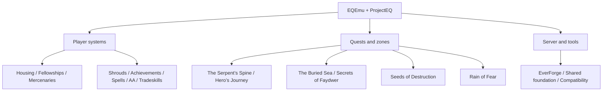

# EQEmu restoration roadmap

A capability map of our additions to EQEmu and ProjectEQ for the May 10, 2013 RoF2 client. This is the first reviewed inventory, not a promise that all content through Rain of Fear is complete.

**Snapshot: November 15, 2026.** [Interactive map](docs/rof2/roadmap/index.html) · [Project overview](README.md) · [Feature source](extensions/rof2/)

The sections below expand directly on GitHub. GitHub displays the interactive HTML as source: download that file and open it in a browser for the clickable map. Hosting through GitHub Pages is a separate optional step; no hosted URL is claimed here.

## Reading the status

| Status | Meaning |
| --- | --- |
| Published scope/package | Available in public source or reviewed content packages; supported scope varies. This alone is not proof of activation or every gameplay variation. |
| Published + ongoing | Reviewed work exists, with further families or batches unfinished. |
| Native accepted · local | The recorded local gameplay scope passed; it is not yet a published download. |
| Source package · acceptance pending | Implementation is available for review; activation or gameplay acceptance remains pending. |

## Player systems

Housing — Published scope

Personal and guild homes built around the native RoF2 housing interface.

- **Neighborhoods & plots:** Sunrise Hills neighborhoods, plot purchase, upkeep and property access.
- **Homes & guild halls:** Place houses and halls, enter their interiors, and route guild members through the Guild Lobby.
- **Decoration & layouts:** Move, rotate and scale furnishings; wall and ceiling placement; save and restore layouts.
- **Storage & services:** Closets, vaults, sheds and moving crates; parcel returns; supported bankers, vendors and travel services.

**Remaining / qualified scope:** Supported item identity and contents are preserved across moves. This is a substantial native housing implementation, not a claim of every Live housing feature.

[Source and scope notes](extensions/rof2/housing/)

Fellowships — Published scope

Small-group social features, camps and shared experience.

- **Membership & chat:** Up to 12 members, invitations, leadership, MOTD, native window and cross-zone fellowship chat.
- **Campsites:** Free and paid camps, kit/lumber costs, expiry and nearby combat or utility effects.
- **Travel & access:** Insignia travel with instance admission checks; fellowship-aware housing permissions.
- **Experience sharing:** Normal and AA experience sharing, offline vitality banks, redemption and native gauges.

**Remaining / qualified scope:** Broad lifecycle checks were exercised with three native clients. Every individual camp recipe and exact Live balance are not claimed.

[Source and scope notes](extensions/rof2/fellowship/)

Mercenaries — Published scope

Native hiring and management with four roles and progression through level 100.

- **Four roles:** Tank, healer, melee damage and caster damage, with level 86–100 stat and spell support.
- **Management:** Hire, suspend, revive, select stances and manage persistent contracts in the native interface.
- **Combat & upkeep:** Role-aware assistance, healer behavior, coin upkeep and Bayle Mark fallback.
- **Ownership & progression:** Configurable multiple owned contracts with one active; earned Journeyman II acquisition in the accepted Oceangreen slice.

**Remaining / qualified scope:** Some scaling is reconstructed. Marketplace slot/rename commerce, later mercenary AAs and player-equipped mercenary gear are not implemented. Earned J3 progression now has local native acceptance for one ordinary level-100 healer hire; publication is pending. See Kithicor in Quests & zones.

[Source and scope notes](extensions/rof2/mercenaries/)

Spirit Shrouds — Published scope

Native transformation, original-character restoration and earned shroud progression.

- **Selection & transformation:** Native selection and preview, original-character escrow and restoration.
- **Enabled forms:** Eight starting forms, in level steps from 5 through 70: 112 enabled combinations.
- **Abilities & rewards:** Monster Point purchases, 47 paid AA groups / 329 ranks, and earned-item retrieval.
- **Persistent accounting:** Original character XP/AA accounting and recovery for corpse and transformation state.

**Remaining / qualified scope:** Later branches remain disabled or incomplete. Enabled catalogue coverage does not establish gameplay acceptance of every form and level.

[Source and scope notes](extensions/rof2/spirit-shrouds/)

Achievements — Published scope

Native achievement tracking connected to restored quest routes.

- **Native display:** Definitions, categories, progress, comparisons and completion notifications.
- **Durable progress:** Persistent achievement and task state, with event hooks for quest authors.
- **Reward choices:** Persistent reward options, permanent-class filtering and common reward claims.
- **Content packages:** Scoped Hero’s Journey and Rain of Fear quest groups; select Quests & zones for the content breakdown.

**Remaining / qualified scope:** The researched achievement inventory is larger than the playable catalogue. Entire expansion completion is not claimed.

[Source and scope notes](extensions/rof2/achievements/)

Spells & acquisition — Published scope

Restore ways to obtain spells, alongside targeted content and engine repairs.

- **Vendors & eligibility:** Missing scroll stock, faction requirements and Alaran language checks.
- **Original exchanges:** Runes, fragments, motes, cantrips and periapts; class-aware reward choices and bundle handling.
- **Expansion coverage:** Restored acquisition routes across TSS, SoF, SoD, Underfoot, HoT, VoA and RoF.
- **Content corrections:** Targeted summon items and spell content; optional reconstructed pets and auras are separately documented.

**Remaining / qualified scope:** Not every spell effect, acquisition route or faction path is complete. Optional estimated pet/aura content is not enabled by default.

[Source and scope notes](extensions/rof2/spells/)

Alternate Abilities — Published + ongoing

Targeted restoration and corrections, with further families still under review.

- **Published core work:** Origin and knight innate support, alongside reviewed AA data corrections.
- **Eligibility & progression:** Targeted requirements and progression handling for the reviewed ability families.
- **Further batches:** Additional data batches have been published; other AA proposals remain local, queued or awaiting gameplay checks.

**Remaining / qualified scope:** This is not a completed through-RoF AA catalogue. The next inventory pass should list accepted ability families individually, with their publication and gameplay evidence.

[Source and scope notes](extensions/rof2/aa/)

Tradeskills — Published + ongoing

Recipe restoration plus support for special combines and item-preserving hand-ins.

- **Recipe & ingredient work:** Reviewed recipe additions, ingredient corrections and through-RoF recipe auditing.
- **Special crafting:** Charged items, reviewed recharge combines and quest crafting consumer support.
- **Latest published cohort:** RRC312-r2 adds a finite 32-recipe batch, with its reconstruction choices documented.
- **Remaining research:** Three unsupported groups remain in the recorded final checkpoint; unknown historical values are not treated as verified originals.

**Remaining / qualified scope:** Full database recipe totals include existing EQEmu/PEQ content and are not counts of recipes we added. A per-batch ledger is the next useful breakdown.

[Source and scope notes](extensions/rof2/tradeskills/)

## Quests & zones

### The Serpent’s Spine / Hero’s Journey

Crescent Reach — Published package

Scoped starter and achievement quest restoration.

- **Main routes:** Council of Six, Making a Name for Yourself and Becoming a Hero.
- **Supporting content:** Starter definitions, prerequisites, recipes, objects, drops and merchant supplies.
- **Baker Shivra:** Both Baker routes, native hand-ins, rewards and persistent achievement checks.

**Remaining / qualified scope:** Graduate of Crescent Reach is not fully native-validated; unrecovered rewards are not invented.

[Source and scope notes](extensions/rof2/achievements/content/crescent/)

Blightfire Moors — Published packages

Several restored quest families within one zone.

- **General quest routes:** Core Moors package and its achievement groups.
- **Bixies & Makesn:** Bixie-related routes and supporting quest objectives.
- **Spirits & combat:** Battling the Blightfire Spirits and combat-focused quest routes.
- **Welcome & Champion:** Welcome to the Moors and Champion routes, with parent reward dependencies.

**Remaining / qualified scope:** Package families overlap zone content; their counts are not added together as a unique zone-wide completion total.

[Source and scope notes](extensions/rof2/achievements/content/)

Stone Hive — Published packages

Quest and achievement routes, including A Short Sharp Sting.

- **Core package:** 16 quest routes and four achievement groups in the scoped package.
- **A Short Sharp Sting:** Journal/container work, recipes, faction and copied encounters.
- **Rewards & objectives:** Quest-object interactions, component progression and restored reward paths.

**Remaining / qualified scope:** Package inclusion is separate from native Windows acceptance. Exact scope and provenance remain in each package.

[Source and scope notes](extensions/rof2/achievements/content/stonehive/)

Goru’kar Mesa — Published packages

Core routes plus additional Mesa quest families and encounters.

- **Core quest routes:** 19 routes with native completion recorded; the twentieth capture quest remains disabled.
- **Additional families:** Armor, paid gifts, centaur and Bring Friends-related content.
- **Scripted encounters:** Kathryn’s defense, corpse-note work and Simu’s escort.
- **Supporting crafting:** Additional task activities, quest recipes and historical achievement definitions.

**Remaining / qualified scope:** Missing head rewards, Berserker Pranks and the disabled capture route remain distinct gaps.

[Source and scope notes](extensions/rof2/achievements/content/mesa/)

Blackfeather Roost — Published package

Restored quest routes, jewelry reward paths and nest encounters.

- **Quest coverage:** 15 scoped quests and their activities and achievement definitions.
- **Rewards:** Three parent jewelry reward sets.
- **Encounters:** Nest combat and lifecycle scripting.

**Remaining / qualified scope:** Two armor reward-choice sets remain unresolved.

[Source and scope notes](extensions/rof2/achievements/content/roost/)

The Steppes — Published package

Quest routes and shared crypt content.

- **Quest & rewards:** 13 scoped routes, achievement definitions and four reward sets.
- **Shared crypt:** Three-player native checks, shared rejoin and completed-member reconnect behavior.

**Remaining / qualified scope:** Late joining and pickup behavior retain documented limitations.

[Source and scope notes](extensions/rof2/achievements/content/steppes/)

Sunderock Springs — Published package

Restored quest routes with item reward paths.

- **Quest routes:** 15 scoped routes and 56 objectives.
- **Rewards:** Four parent-item reward paths and supporting quest state.

**Remaining / qualified scope:** Numeric faction rewards and Mines raid-access work remain unfinished.

[Source and scope notes](extensions/rof2/achievements/content/sunderock/)

Vergalid Mines — Published package

Quest objectives, restored actors and persistent key/object interactions.

- **Quest routes:** 17 scoped quests, four parent reward paths and seven restored actor types.
- **Interactive objects:** Chest and bait behavior, charged-shard statue and shared orb.
- **Persistence:** Key state and shared quest progress handling.

**Remaining / qualified scope:** Multiplayer and Windows gameplay acceptance retain package-specific limits.

[Source and scope notes](extensions/rof2/achievements/content/vergalid/)

### The Buried Sea / Secrets of Faydwer

The Buried Sea — Published scope

Island quest progression, the skeletal-hand collection and a real group mission.

- **Island routes:** 39 scoped island quests and seven armor reward sets.
- **Jonas Dagmire’s hand:** All 27 bones and seven native compound recipes.
- **Mer’s mission:** Real three-member mission, member rewards and Halon stock.
- **Travel:** Ferries and rowboats, with native completion and login persistence checks.

**Remaining / qualified scope:** This is the reviewed island/mission slice, not a claim that the whole expansion is restored.

[Source and scope notes](extensions/rof2/achievements/README.md)

Dragonscale Hills — Published package

Quest routes spanning three achievement families.

- **Quest families:** Strike Force, Challenges and Ladies of the Light.
- **Quest objects & scenes:** Farm gears, banner, crystal canvas and rescue interactions.
- **Acceptance:** Native completion of all three scoped achievement families and relog persistence recorded.

**Remaining / qualified scope:** Scope covers the 15-route package, not every quest or encounter in Dragonscale Hills.

[Source and scope notes](extensions/rof2/achievements/content/dragonscale/)

### Seeds of Destruction

Oceangreen → Void B / J2 — Published · native accepted

The newly accepted ten-task village and Blackburrow progression slice.

- **Ten tasks:** Six personal tasks and four shared missions, completed on the matched local server.
- **Shared missions:** Stop the Contamination, A Dread Challenger, Freedom! and Beat the Blackburrow Boss; once-only rewards for two real recipients.
- **Earned progression:** Void B admission, real scroll purchase and scribing, and ordinary level-100 Journeyman II healer hiring.
- **Travel & persistence:** Hills/Blackburrow travel and mission returns; history, currency, rewards and mercenary state checked through fresh logins.

**Remaining / qualified scope:** Upper-ward physical blocking remains LIMITED. Encounter numbers are local reconstruction. Linux native acceptance does not establish Windows gameplay acceptance.

[Source and scope notes](docs/rof2/OCEANGREEN.md)

Kithicor → Void C / J3 — Native accepted · local

Recorded local gameplay acceptance for six Kithicor tasks and the next earned progression step. Publication is pending.

- **Six tasks & shared rewards:** Four personal tasks plus Safe’s original two-stage mission and Bitter. Actual physical stages, refugees and rewards passed; 31 reward components were paid, with two real shared-mission recipients.
- **Earned Void C:** Original door progression into Void C and 22 cumulative vendor rows checked through the native client.
- **Scroll & Journeyman III:** One Mindfreeze scroll purchase and spell scribing, then one ordinary level-100 Journeyman III healer hire. Existing contracts, spells and items were preserved.
- **Release preparation:** The matched source/content batch and sanitized database package are being prepared. No published release is claimed yet.

**Remaining / qualified scope:** Accepted scope is local; publication is pending. A later escort-homing fix has focused source/mock evidence but awaits a fresh gameplay check. Some escort and NPC ready/return behavior remains unproved. Numeric reconstruction is user-approved, not exact historical parity. Local acceptance milestone recorded November 15.

### Rain of Fear

Shard’s Landing — Published package

Partisan progression and portal prerequisites.

- **Partisan arc:** Nine scoped tasks, including portal prerequisite content.
- **Achievement links:** All eight configured Partisan components checked natively.
- **Group behavior:** Additional multiplayer checks retained with the package evidence.

**Remaining / qualified scope:** This package does not establish completion of every Shard’s Landing quest or encounter.

[Source and scope notes](extensions/rof2/achievements/content/shards-landing/)

Valley of King Xorbb — Source package · acceptance pending

An inactive source package containing partisan and mercenary quest components.

- **Quest package:** 14 quest definitions and 120 objective source paths.
- **Actors & scenes:** NPC profiles, caster bindings and owned scenes for Lurr, Grolak and Gronk.
- **Objects & crafting:** Garden pickups, colored crystal interactions and the Hollowflesh coffin recipe.
- **Shared support:** Native delivery, run persistence and fixed reward definitions.

**Remaining / qualified scope:** The package README records inactive content and pending native acceptance. Do not equate published source with installed or playable quest completion; this area needs receipt reconciliation.

[Source and scope notes](extensions/rof2/achievements/content/xorbb/)

## Server & tools

EverForge — Published · 0.3.0

A packaged server stack with our administration tools and persistent installations.

- **Server stack:** Published RoF2 server, setup and matched database contracts in Docker.
- **Administration:** Source-built Spire and PEQ Editor forks, real World administration and phpMyAdmin.
- **Access utilities:** SSH/SFTP and FTPS, with documented ports and network setup.
- **Backup & upgrades:** Complete private backup/restore, retained data volumes and deliberate release selection.

**Remaining / qualified scope:** Authorized original resources are supplied separately. Existing installations retain their data; ordinary restart is not a database reseed or server upgrade.

[Source and scope notes](docs/rof2/EVERFORGE.md)

Shared feature foundation — Published scope

Reusable server improvements connecting the restored systems.

- **Reward & task delivery:** Persistent reward choices, class eligibility, task credit and shared rewards.
- **Inventory custody:** Item identity, contents and delivery handling used by housing, quests and exchanges.
- **Native world interactions:** Owned click objects, transient doors, quest pickup identity and transport passenger state.
- **Quest authoring:** Supporting hooks and APIs for the restored content packages.

**Remaining / qualified scope:** Infrastructure support does not prove that every dependent scene or quest has passed native acceptance.

[Source and scope notes](extensions/rof2/shared-core/)

Client stability & releases — Published scope

Targeted compatibility repairs and matched release packaging.

- **Character selection:** Published RoF2 character-selection crash repair.
- **Interrupt messages:** Measured repair to the interrupt-message packet writer, included in the accepted Oceangreen source.
- **Release delivery:** Linux and Windows build/package workflows, server downloads and matching database references.

**Remaining / qualified scope:** Compilation, publication and native gameplay acceptance are separate evidence. A bounded repair is not a guarantee that all crashes or CI failures are resolved.

[Source and scope notes](docs/rof2/OCEANGREEN.md)

## Next roadmap refinements

- Reconcile the remaining source packages against accepted installation and release receipts.
- Expand AA coverage into individual accepted ability families.
- Expand tradeskills into reviewed recipe batches without counting existing PEQ recipes as new additions.
- Add individual quest names and acceptance evidence beneath each zone.
- Keep native acceptance, source publication and released downloads separate; add dates only when an actual milestone exists.

## Provenance and upkeep

The published overview was checked at [`99c1162`](https://github.com/nightstalker6669/EQEmu/tree/99c11623c2cf5ed15b0f0830a3aecea28528fc21). Content-package notes have different validation histories. Kithicor’s local acceptance was reported by the coordinator and its final native receipt hash was checked separately; it remains explicitly unpublished in this snapshot.

Original or uncertain encounter values that were reconstructed locally are not presented as authenticated historical Live values. Original EQEmu and ProjectEQ work retains its community attribution.

Roadmap Chat maintains this inventory using accepted-scope handoffs. Update this document and the interactive map together when publication or acceptance changes. Do not attach private operational receipts, credentials, character records or proprietary client assets.

[Back to project overview](README.md)
